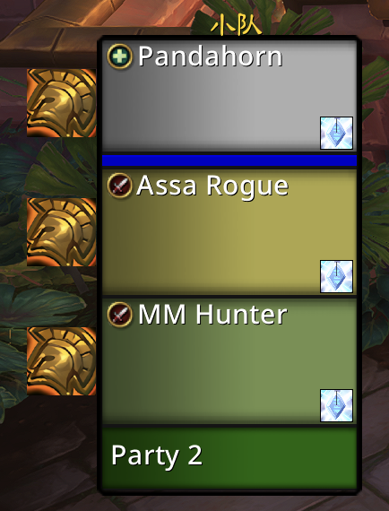
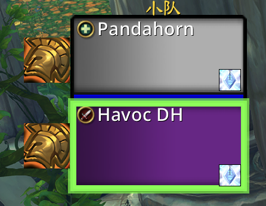
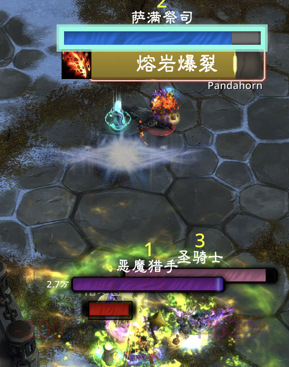
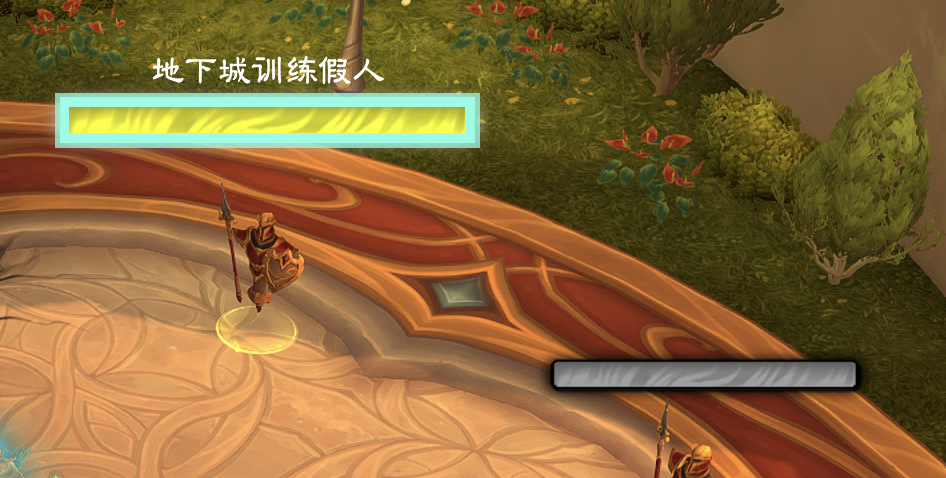

# Pandahorn Gameplay Toolbox

A lightweight addon for World of Warcraft Retail 12.1.5 and WoW: Forever (1.60.1), for identifying arena teammates and spotting your current target.

## Arena teammate names

On Retail, replace teammate names on party frames and the friendly Target Frame in arenas with specialization and class, such as `Holy Pal`. Your own name stays unchanged by default; normal names return when you leave the arena.

Friendly Identity is disabled by default and unavailable on WoW: Forever because it has no arenas.

## Party frame target highlight

Highlight your selected teammate on Blizzard party / raid-style party frames. Arena-only by default on Retail, with an option to enable it elsewhere. On Forever, it works in all zones by default; an imported arena-only preference does not prevent highlighting.

## Nameplate target highlight

Add a clear border and glow to your current enemy or friendly target's nameplate. Configure it independently from party frame highlighting, including color and thickness.

## Installation and settings

Extract the release ZIP into `World of Warcraft/_retail_/Interface/AddOns/`, with the addon inside a `PandahornGameplayToolbox` folder.

For WoW: Forever, use that client's `Interface/AddOns/` directory instead. The same ZIP supports both clients.

Open **Esc → Options → AddOns → Pandahorn Gameplay Toolbox** to adjust feature toggles, name formats, and highlight styles. Changes apply immediately.
